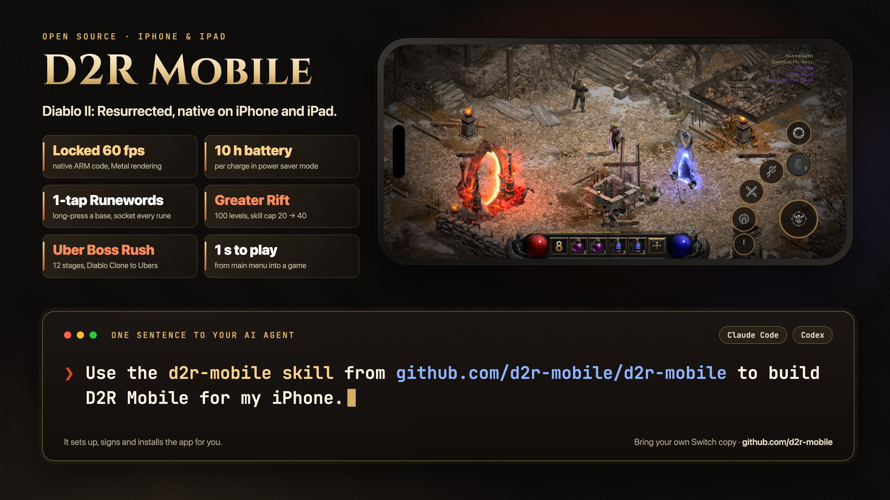

<p align="center">
  <a href="https://github.com/d2r-mobile/d2r-mobile"></a>
</p>

## [→ d2r-mobile/d2r-mobile](https://github.com/d2r-mobile/d2r-mobile)

**Diablo II: Resurrected, running as native code on iPhone and iPad.** Bring the Switch release you own (Reign of the Warlock, 3.3.94012) and your phone runs its ARM program directly, drawn with Metal, with every control rebuilt for touch.

Build it with one sentence to Claude Code or Codex:

```
Use the d2r-mobile skill from https://github.com/d2r-mobile/d2r-mobile to build D2R Mobile for my iPhone.
```

**《暗黑破坏神 II：狱火重生》原生跑在 iPhone 和 iPad 上。** 满帧 60 fps，省电模式续航 10 小时，一键符文之语，100 层大秘境。对 Claude Code 或 Codex 说一句话就能复刻：

```
用 https://github.com/d2r-mobile/d2r-mobile 里的 d2r-mobile skill，帮我把 D2R Mobile 装到我的 iPhone 上。
```

[README](https://github.com/d2r-mobile/d2r-mobile#readme) · [中文说明](https://github.com/d2r-mobile/d2r-mobile/blob/main/README.zh-CN.md) · [Releases](https://github.com/d2r-mobile/d2r-mobile/releases) · [Issues](https://github.com/d2r-mobile/d2r-mobile/issues)

<sub>Independent, non-commercial, MIT. Not affiliated with Blizzard Entertainment or Nintendo. You must own the game; the repository contains no game content.</sub>
